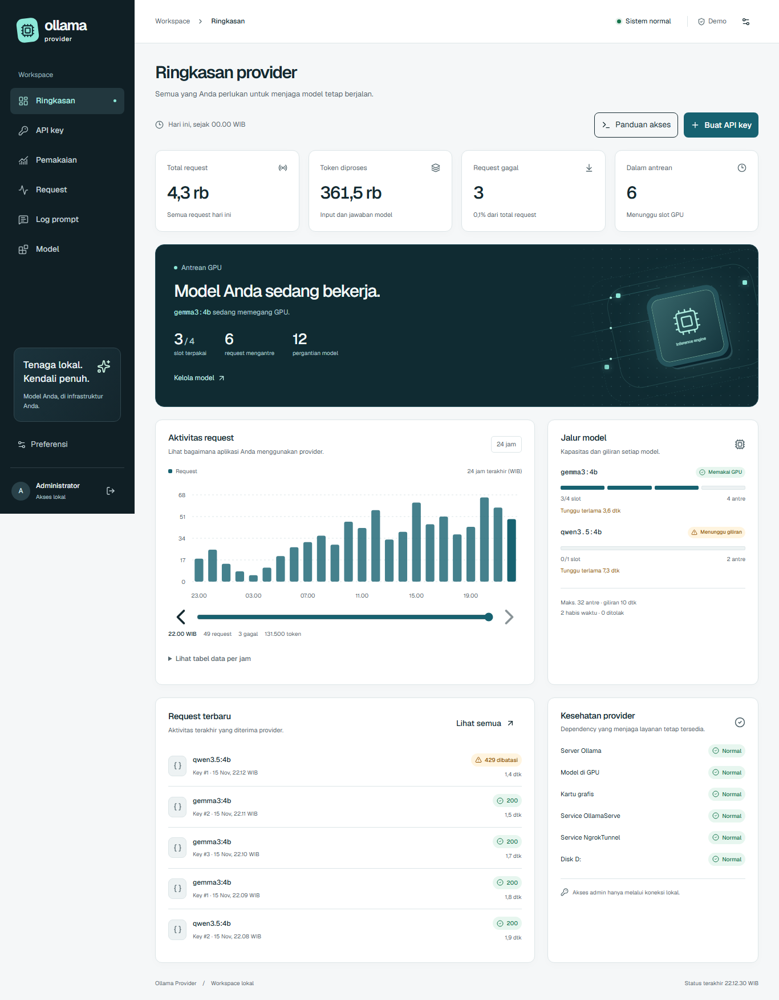

# Audit dan redesign dashboard

Tanggal: 15 November 2026. Audit berdasarkan source, browser dengan data simulasi, dan pengujian perilaku; tidak memakai isi prompt maupun key produksi.

## Masalah yang diperbaiki

| Temuan awal | Hasil implementasi |
|---|---|
| Dua klik cepat membuat dua POST key | Pengunci sinkron dan tombol pending; secret ditampilkan sekali |
| Nilai edit tidak valid dikirim, error hanya HTTP 422 | Validasi native, error per field, fokus ke field bermasalah |
| Data lama tampak normal ketika refresh gagal | Banner kegagalan persisten, retry, waktu pembaruan |
| Tabel key 893 px / prompt 952 px pada area 308 px | Kartu dan panel detail di layar ponsel |
| Grafik hanya melalui hover | Pemilih jam via keyboard/touch, caption, dan tabel data |
| Dialog tidak bernama dan target kecil | Judul/deskripsi terhubung, native focus trap, kontrol minimal 44 px |
| Kontras CTA 4,42:1 terang / 3,64:1 gelap | Palet semantik baru; diperiksa dengan axe pada kedua tema |
| Header tinggi dan menu ponsel terpotong | Header ringkas dan drawer navigasi |
| Navigasi mengganti history | Rute Next.js, Back/Forward, deep link, kompatibilitas hash lama |
| Statistik ikut membesar karena contoh kode | KPI terpisah, ilustrasi antrean GPU, panduan akses dalam panel |

Visual memakai grafit dan sian, font Geist lokal, diagram GPU berbasis SVG/CSS, transisi Motion, GSAP, serta SpotlightCard React Bits. UI tetap berbahasa Indonesia. Enam menu dan kebijakan backend dipertahankan.

## Validasi

- 161 test pytest: API lama, penyajian manifest, hash CSP, penolakan path, dan pembatasan rendering HTML.
- 16 test Playwright: alur utama, key ganda, validasi/PATCH parsial, model, pagination, injeksi teks, logout, error/retry, tema, dan focus.
- Enam halaman diperiksa pada 390, 768, 1366 px, masing-masing terang/gelap: tanpa overflow halaman dan tanpa pelanggaran axe pada aturan WCAG yang dijalankan.
- Dua negative control menghilangkan pengunci submit dan validasi form; regresi gagal sesuai harapan, lalu perubahan dipulihkan.
- Build produksi diperiksa untuk CSP, hidrasi, navigasi, dan resource lokal. Audit npm frontend bersih.
- Test dan preview menggunakan server simulasi di loopback; perubahan ini belum diterapkan melalui restart service produksi.

Ini merupakan hasil pemeriksaan otomatis dan visual, bukan klaim sertifikasi aksesibilitas atau hasil riset pengguna. Screenshot berada di laporan Playwright; cara menjalankan preview ada di [panduan frontend](../frontend/README.md).

## Screenshot hasil

Data pada gambar berikut seluruhnya simulasi.

[Lihat dashboard ponsel](uiux/overview-390-light.png).
